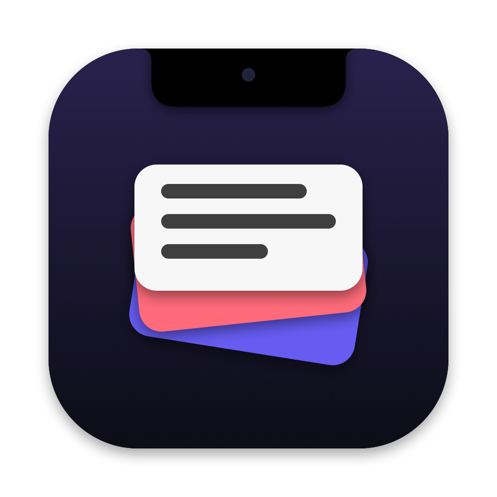
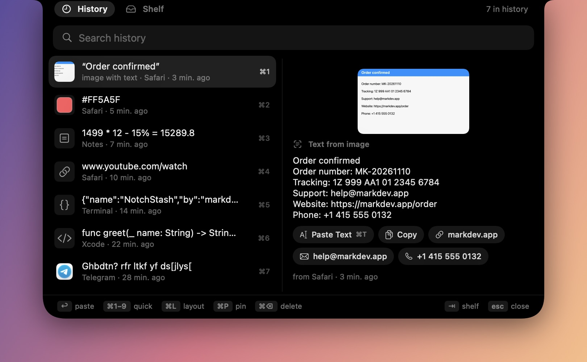
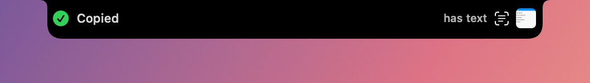
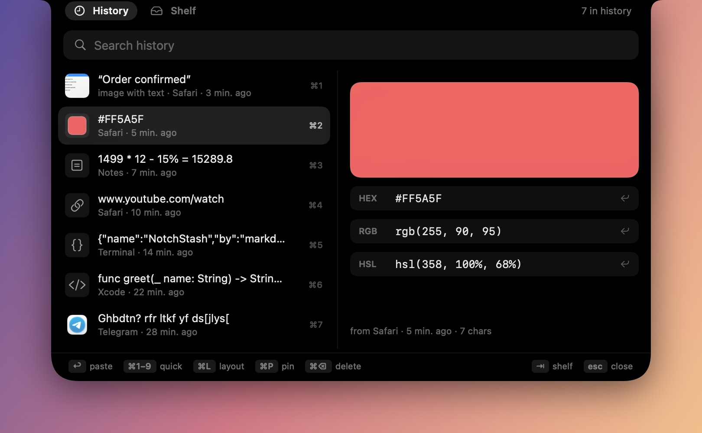
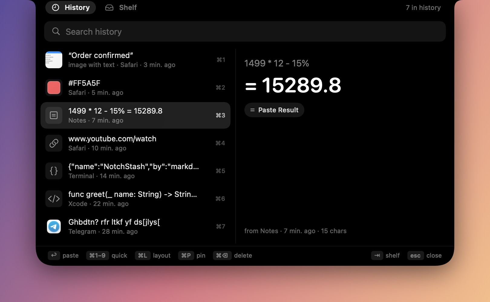
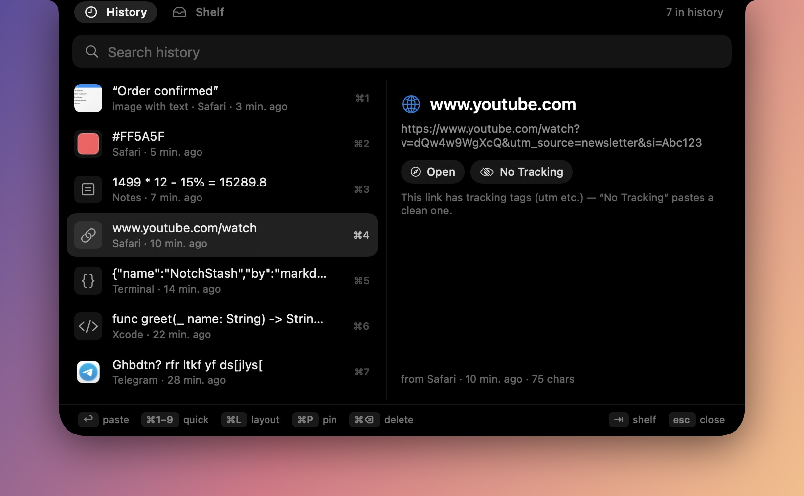
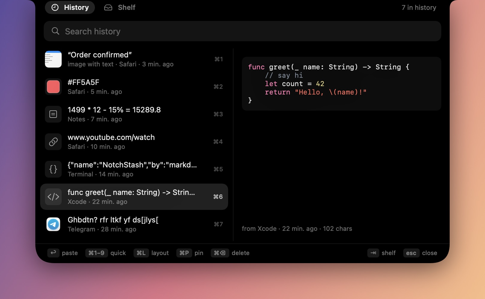
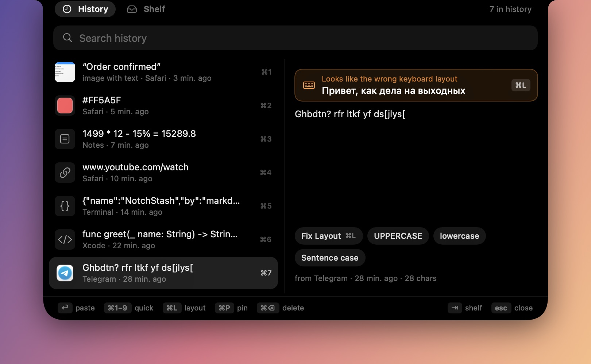
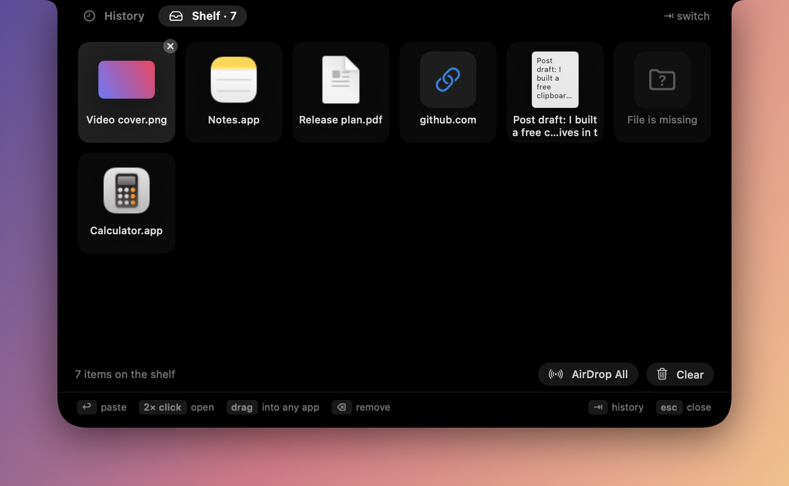

<p align="center">
  
</p>

<h1 align="center">NotchStash</h1>

<p align="center">
  <b>A free clipboard manager that lives in your MacBook's notch.</b><br>
  History, smart cards, text from screenshots and a drag-and-drop shelf — all local, all native.
</p>

<p align="center">
  <a href="https://github.com/markdevjester/NotchStash/releases/latest">Download</a> ·
  <a href="#features">Features</a> ·
  <a href="#shortcuts">Shortcuts</a> ·
  <a href="README.ru.md">Русский</a>
</p>

<p align="center">
  
</p>

## Features

**Clipboard history in the notch.** Everything you copy — text, images, files — is saved and survives restarts. Press **⇧⌘V** or hover over the notch, and the history springs out of it. Search, pin, paste with ↩.

**A tiny flash on every copy.** The notch briefly widens to confirm what you copied.

<p align="center"></p>

**Smart cards.** NotchStash recognises what you copied:

| | |
|---|---|
| **Colors** — `#FF5A5F`, `rgb()`, `hsl()` get a swatch and one-click HEX / RGB / HSL |  |
| **Math** — `1499 * 12 - 15%` shows the answer (percent works like a real calculator) |  |
| **Links** — open, or paste a clean copy without `utm_*`, `fbclid`, `si` and other trackers |  |
| **Code & JSON** — syntax highlighting, pretty / one-line JSON |  |

**Wrong keyboard layout fix.** Typed `ghbdtn` instead of `привет`? NotchStash notices and pastes the fixed text with **⌘L** — both ways, RU ↔ EN, checked against macOS dictionaries.

<p align="center"></p>

**Text from screenshots.** Every copied image is read on-device with Apple Vision (English, Russian, Ukrainian) — that's the card in the screenshot at the top. Paste the text with **⌘T**, tap links, emails and phone numbers right on the card, and find old screenshots by the words on them.

**The shelf.** Drag files, images, links or text to the notch — it opens and keeps them. Drag them back out into any app later, or AirDrop them all at once.

<p align="center"></p>

**Also:** text transforms (translit, UPPER, lower, sentence case, one line), auto-paste into the front app, launch at login, pause, history limit, and password-manager entries are never saved.

## Install

1. Download `NotchStash-1.0.1.zip` from [Releases](https://github.com/markdevjester/NotchStash/releases/latest), unzip, and move `NotchStash.app` to **Applications**.
2. First launch: the app isn't notarized by Apple yet, so macOS will say it can't verify the developer.
   Open **System Settings → Privacy & Security**, scroll down and click **Open Anyway**.
3. The icon appears in the menu bar. Press **⇧⌘V** or hover over the notch.

For instant paste on ↩, allow NotchStash in **System Settings → Privacy & Security → Accessibility**. Without it, items are copied and you paste with ⌘V yourself.

The interface follows your system language — English or Russian. Change it in the menu bar icon → **Language**.

Requires macOS 14 or later. Works on Apple Silicon and Intel; on screens without a notch it draws a virtual one.

## Shortcuts

| Key | Action |
|---|---|
| **⇧⌘V** | Open / close |
| **↑ ↓** · **↩** | Choose · paste into the front app |
| **⌥↩** | Copy only |
| **⌘1 – ⌘9** | Paste item 1–9 |
| **⌘L** | Paste with the keyboard layout fixed |
| **⌘T** | Paste the text from a screenshot |
| **⌘P** · **⌘⌫** | Pin · delete |
| **⇥** | Switch History / Shelf |
| **esc** | Close |

## Privacy

Everything stays on your Mac. NotchStash makes no network requests: OCR and layout checks run on-device. History lives in `~/Library/Application Support/NotchStash/`. Items marked as concealed by password managers are skipped.

## Build from source

No Xcode project needed — just Swift (Xcode or Command Line Tools):

```bash
git clone https://github.com/markdevjester/NotchStash.git
cd NotchStash
zsh build.sh --install   # build a universal app, copy to /Applications, launch
```

Tests (layout fix, calculator, colors, links, JSON, code, shelf, OCR):

```bash
swiftc -swift-version 5 Sources/L10n.swift Sources/Smart.swift Sources/Store.swift Sources/Shelf.swift Sources/OCR.swift Tests/main.swift -o /tmp/notchstash-test && /tmp/notchstash-test
```

## Roadmap

- More interface languages
- Weekly "clipboard wrapped" card you can share
- Translate and summarise copied text with Apple's on-device model
- Signed and notarized builds, Homebrew cask

## License

[MIT](LICENSE) © 2026 markdev
